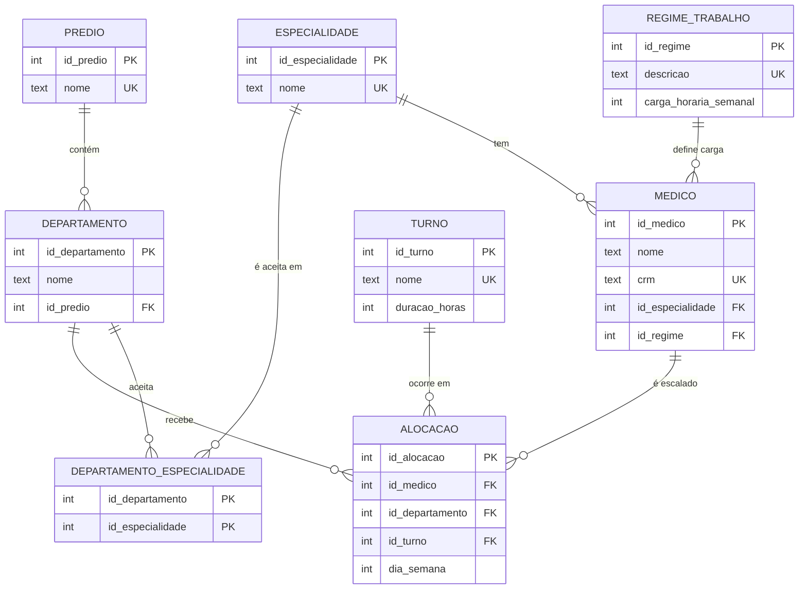

# Projeto Escala Médica
 
Aplicação que organiza a escala semanal dos médicos de um hospital e responde à pergunta:
 
> **Em qual prédio e departamento o médico X está no dia Y, turno Z?**
 
O projeto tem três partes:
 
| Parte | Aula | Conteúdo | Pasta |
|---|---|---|---|
| 1 | Aula 1 | Modelagem, scripts DDL/DML e consultas SQL | `database/`, `docs/` |
| 2 | Aula 2 | API REST com Spring Boot sobre o mesmo banco | `backend/` |
| 3 | Avaliação P2 | Painel de Gestão da Escala: relatórios R1 a R6 | `backend/`, `bruno/p2/` |
 
> Este repositório continua o projeto de Banco de Dados 2, a partir do esqueleto fornecido pelo professor
> (Prof. Stelvio Barboza). As partes 1 e 2 vêm do material do professor; a Parte 3 é o trabalho do grupo.
 
## Estrutura
 
```
projeto-escala-medica/
├── README.md
├── database/
│   ├── base/hospital.sqlite        banco fornecido (médicos, especialidades, regimes)
│   ├── ddl/                        01 a 05: CREATE TABLE das tabelas novas
│   ├── dml/                        01 a 05: INSERTs de prédios, departamentos, turnos e escala
│   ├── queries/                    Q1 a Q6: consultas obrigatórias
│   └── escala.sqlite               banco final (base + DDL + DML)
├── docs/diagramas/
├── backend/                        projeto Spring Boot (Partes 2 e 3)
│   └── data/escala_p2.sqlite       base da P2 (somente leitura)
└── bruno/p2/                       coleção do Bruno com as requisições R0 a R6
```

## Modelo de dados



`medico`, `especialidade` e `regime_trabalho` vêm prontas no `hospital.sqlite` e **não são alteradas**.
As tabelas novas apenas apontam para elas por chave estrangeira, por isso nenhum `ALTER TABLE` é necessário.

## Regras de negócio

| Regra | Descrição | Onde é garantida |
|---|---|---|
| RN01 | Médico não pode ter duas alocações no mesmo dia e turno | `UNIQUE` no banco + serviço |
| RN02 | Departamento precisa aceitar a especialidade do médico | serviço (`AlocacaoService`) |
| RN03 | Soma das horas não pode passar da carga do regime | serviço (`AlocacaoService`) |
| RN04 | `dia_semana` de 1 (segunda) a 7 (domingo) | `CHECK` no banco + `@Min/@Max` |
| RN05 | Todo departamento pertence a um prédio | FK `NOT NULL` |
| RN06 | Não alocar médico, departamento ou turno inexistente | FK no banco + serviço |

## Parte 1: montar o banco

1. Copie `database/base/hospital.sqlite` para `database/escala.sqlite`.
2. Abra a cópia no DB Browser for SQLite, DBeaver ou `sqlite3`.
3. Execute `PRAGMA foreign_keys = ON;`.
4. Rode os scripts de `ddl/` e depois os de `dml/`, sempre na ordem numérica.
5. Confira com as consultas de `queries/`. A Q4 deve retornar vazio.

Com o `sqlite3` no terminal:

```bash
cd database
cp base/hospital.sqlite escala.sqlite
cat ddl/*.sql dml/*.sql | sqlite3 -cmd "PRAGMA foreign_keys = ON;" escala.sqlite
```

## Parte 2: rodar o backend

Requisitos: **Java 17 ou superior**. O Maven não precisa estar instalado, o wrapper (`mvnw`) baixa sozinho.

```bash
cd backend
./mvnw spring-boot:run          # Linux / macOS
mvnw.cmd spring-boot:run        # Windows
```

A API sobe em `http://localhost:8081` usando a base `backend/data/escala_p2.sqlite`
(configurada em `application.properties`, aberta em modo somente leitura).
Veja `backend/README.md` para a lista de endpoints e `backend/requests.http` para requisições prontas.
 
## Parte 3: Painel de Gestão da Escala (Avaliação P2)
 
A diretoria pediu um Painel de Gestão da Escala. A equipe de frontend definiu o contrato de seis
endpoints (R1 a R6): URL, parâmetros, nome exato de cada campo e ordem das linhas. O grupo escreveu as
consultas no `PainelRepository` e as ligou ao `PainelService`. O `PainelController` e os records de
resposta (`dto/painel`) vieram prontos e **não foram alterados**. Todos os relatórios são somente leitura.
 
### Endpoints
 
| Relatório | Endpoint | Parâmetros | O que devolve | Consulta (SQL) | Implementação (Java) |
|---|---|---|---|---|---|
| R0 | `GET /api/painel/exemplo/medicos-por-regime` | nenhum | Médicos por regime de trabalho (exemplo do professor) | Professor | Professor |
| R1 | `GET /api/painel/especialidades` | nenhum | Horas alocadas por especialidade e quantos médicos estão escalados | Victor | Gustavo |
| R2 | `GET /api/painel/predios` | nenhum | Departamentos, plantões, médicos e horas de cada prédio | Victor | Gustavo |
| R3 | `GET /api/painel/ranking-carga` | `limite` (opcional, padrão 5, de 1 a 36) | Top N de médicos mais perto do limite de carga do regime | Victor | Gustavo |
| R4 | `GET /api/painel/departamentos-descobertos` | `dia` (obrigatório, de 1 a 7) | Departamentos sem nenhum médico no dia escolhido | Victor | Gustavo |
| R5 | `GET /api/painel/plantonistas-noturnos` | `minimo` (opcional, padrão 2) | Médicos com pelo menos `minimo` plantões no turno Noite | Victor | Gustavo |
| R6 | `GET /api/painel/dias` | nenhum | Médicos, departamentos e horas de cada dia da semana | Victor | Gustavo |
 
`dia`: 1 = segunda ... 7 = domingo.
 
### Como as consultas foram feitas
 
| Relatório | Técnica principal |
|---|---|
| R1 | `LEFT JOIN` em cadeia (médico, alocação, turno), `COUNT(DISTINCT)` e `COALESCE`, para especialidades sem escala aparecerem com 0 |
| R2 | `LEFT JOIN` a partir de departamento, para o departamento sem alocação continuar sendo contado |
| R3 | `INNER JOIN` (só médicos com escala), `SUM` das horas e `ORDER BY` com dois desempates; `limit` vem do parâmetro e o percentual com 1 casa é calculado pelo record `RankingCargaResponse` |
| R4 | Subconsulta correlacionada com `NOT EXISTS` |
| R5 | `WHERE` para o turno Noite e `HAVING` para o mínimo de noites |
| R6 | `GROUP BY` por dia da semana (o nome do dia é preenchido pelo record `ResumoDiaResponse`) |
 
### Testes no Bruno
 
A coleção está em `bruno/p2`, com uma requisição salva por relatório (R0 a R6).
A URL base fica na variável `baseURL` da coleção (`http://localhost:8081`).
Documentação gerada pelo Bruno: `bruno/p2/p2-documentation.html`.
 
### Fluxo de Git
 
- Branch `feature/p2-painel`, criada a partir da `develop`.
- Um commit por relatório, com o código na mensagem (ex.: `R4: departamentos descobertos com NOT EXISTS`).
- Pull Request de `feature/p2-painel` para `develop`, revisado por outro integrante, e depois de `develop` para `main`.
